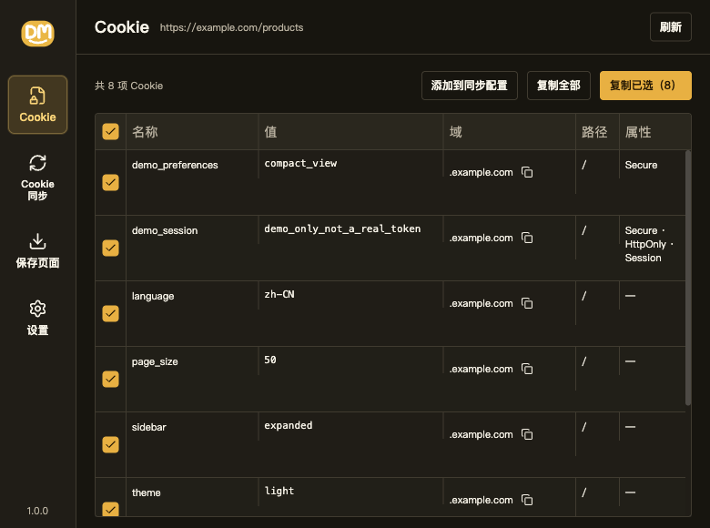
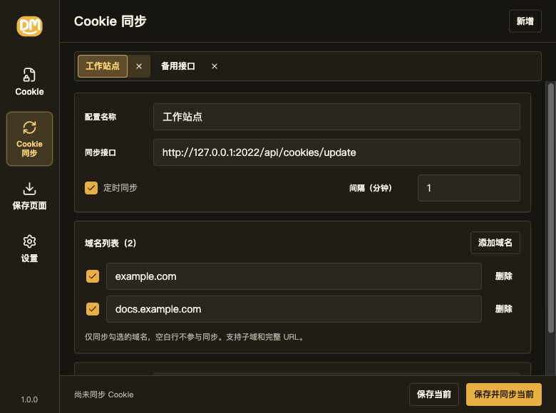
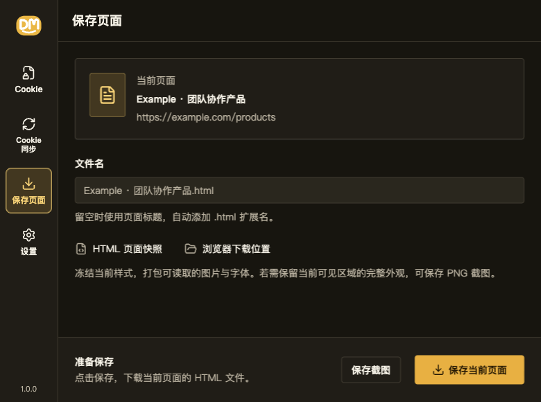
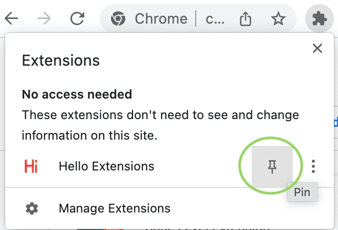

<a id="readme-top" data-n="readme-top"></a>


# Download & Manage

面向 Chrome 138+ 的 Manifest V3 浏览器扩展，是 [wx_channels_download](https://github.com/ltaoo/wx_channels_download) 项目下载功能的配套插件，提供 Cookie 管理、同步和页面保存功能。

**无需构建、无需安装依赖、无需 CDN，克隆后即可加载。**

[界面截图](#界面截图) · [快速开始](#快速开始) · [报告问题](https://github.com/ltaoo/dm-extension/issues) · [提出建议](https://github.com/ltaoo/dm-extension/issues/new)

<details data-n="readme-contents">
<summary data-n="readme-contents-toggle">目录</summary>

- [项目介绍](#项目介绍)
- [界面截图](#界面截图)
- [快速开始](#快速开始)
- [权限与数据](#权限与数据)
- [本地开发](#本地开发)
- [已知限制](#已知限制)
- [参与贡献](#参与贡献)
- [许可证](#许可证)
- [致谢与参考](#致谢与参考)

</details>

## 项目介绍

弹窗主菜单按顺序包含以下五项：

| 菜单 | 可以做什么 | 入口 |
| --- | --- | --- |
| Cookie | 分页查看当前站点 Cookie（含 HttpOnly），复制全部或已选项，勾选一个或多个同步配置并添加当前域名 | 弹窗 → Cookie |
| Cookie 同步 | 管理多个同步接口、域名范围、加密方式与定时任务 | 弹窗 → Cookie 同步 |
| 定时访问 | 按间隔在后台静音打开网站，停留指定秒数后关闭 | 弹窗 → 定时访问 |
| 保存页面 | 下载当前页面的 HTML 快照，或无需滚动生成 PNG 长截图 | 弹窗 → 保存页面 |
| 设置 | 配置域名解析规则，查看项目介绍与版本 | 弹窗 → 设置 → 保存页面 / 关于 |

项目使用原生 JavaScript ES modules、Chrome Extensions API、Timeless 0.33.0、dmui 组件与 CryptoJS 4.2.0。运行所需的第三方资源均随仓库提供。

## 界面截图

以下为 `1.0.0` 版本界面，使用虚构的 `example.com` 演示数据。

**Cookie**：查看站点 Cookie，选择后复制，或在同步配置下拉中勾选一个或多个配置，将当前站点的 `*.主域名` 规则（例如 `www.zhihu.com` → `*.zhihu.com`）直接添加到所选配置，不跳转页面。已在配置中的域名会跳过，并在提示中汇总数量。IP 地址及 localhost 保留原值。



**Cookie 同步**：管理多个同步接口、域名范围与定时任务。

支持 FindRSS 的 `https://scripts.findrss.cloud/api/cookies/update`。选择 AES 加密方式，并填写与服务端一致的 UUID 和密码，无需额外令牌或上传签名。域名列表决定覆盖范围，勾选站点的空 Cookie 列表也会清除服务端旧值；建议同步间隔设为 5 分钟。明文模式接入需要 Bearer 鉴权的接口时请使用其他支持请求头的客户端。现有自定义同步接口继续兼容原有数据字段。



**保存页面**：设置文件名，保存 HTML 页面快照或整页 PNG 长截图（下图为旧版界面，截图按钮现为「保存长截图」）。



## 快速开始

### 环境要求

- Chrome **138 或更新版本**。
- Cookie 读取与页面保存在普通 **HTTP(S) 页面**上使用；`chrome://` 等浏览器内部页面不支持。

### 加载扩展

1. 从 [Releases](https://github.com/ltaoo/dm-extension/releases) 下载 `dm-extension.zip` 并解压，或克隆仓库：

   ```sh
   git clone https://github.com/ltaoo/dm-extension.git
   cd dm-extension
   ```

2. 打开 `chrome://extensions`，开启「开发者模式」。
3. 点击「加载已解压的扩展程序」，选择解压目录或仓库根目录（包含 `manifest.json` 的目录）。

   图中右上角的 **Developer mode** 对应「开发者模式」，左上角的 **Load unpacked** 对应「加载已解压的扩展程序」。

   

4. 打开一个 HTTP(S) 页面，点击浏览器右上角的拼图图标，在扩展列表中找到 **Download & Manage**，点击图钉将其固定到工具栏，再点击扩展图标即可使用。

   

以上两张截图来自 Google 的 [Chrome 官方扩展入门教程](https://developer.chrome.com/docs/extensions/get-started/tutorial/hello-world?hl=zh-cn#load-unpacked)，按 [CC BY 4.0](https://creativecommons.org/licenses/by/4.0/) 许可使用，原图未修改。截图中的 **Hello Extensions** 是官方示例，安装本项目后显示的名称为 **Download & Manage**。

不需要运行 `npm install` 或启动开发服务器。修改扩展代码后，在 `chrome://extensions` 中重新加载扩展，再重新打开弹窗或相关扩展页面。

### 第一次保存页面

1. 打开目标网页，在弹窗主菜单选择「保存页面」。
2. 按需填写文件名，留空时使用页面标题。
3. 点击「保存当前页面」下载 HTML 快照；需要整页图片时，点击「保存长截图」下载 PNG。长截图会自动识别主内容区域，展开内容副本并通过 SVG 渲染，无需滚动原页面；检测到独立内容容器时仅保存该区域，排除外部 Header 和侧栏。保存期间保持弹窗打开；图片或字体无法打包时会显示缺失提示。

### 定时访问网站

1. 重新加载扩展，点击左侧「Cookie 同步」下方的「定时访问」。
2. 点击右上角「新增」，在新记录中填写完整的 HTTP(S) 网址、访问间隔（0.5～10080 分钟）和停留时间（1～86400 秒），点击该记录的「保存」。首次自动访问在一个间隔后执行。
3. 每条任务直接以表单显示，可原地修改并保存，也可暂停、删除或「立即访问」。有未保存修改时，先保存再启用、暂停或立即访问；新任务在保存前不会执行，关闭弹窗会丢弃未保存修改。暂停会停止后续访问，已打开的任务页仍会按原定时间关闭；同一任务未结束时跳过重复执行。

任务会创建一个不激活的后台标签页，先静音再加载网址，不切换你正在使用的标签或聚焦窗口。停留时间从打开时计算，不等待页面加载完成；到期只关闭本次创建的标签，若你正在查看该任务页则保留它。只使用已有的普通浏览器窗口，不会新建窗口。

浏览器必须保持运行。闹钟可能因休眠、系统繁忙或后台进程调度而延迟，秒数不是严格的实时保证。后台进程重新启动会恢复当前会话的关闭任务；浏览器重启或重新加载扩展后，临时关闭记录会清空，旧任务页可能保留，避免使用过期标签 ID 误关其他页面。后台页面也可能受网站的可见性检测和浏览器节流影响。参见 [Tabs API](https://developer.chrome.com/docs/extensions/reference/api/tabs)、[Alarms API](https://developer.chrome.com/docs/extensions/reference/api/alarms) 和 [session 存储](https://developer.chrome.com/docs/extensions/reference/api/storage#property-session)。

## 权限与数据

| 权限 | 用途 |
| --- | --- |
| `activeTab`、`scripting` | 读取当前页面、捕获样式与内容，以及截取当前可见区域 |
| `cookies` | 读取站点 Cookie，供查看、复制和同步 |
| `userScripts` | 供代码中保留的变更检测模块执行用户脚本，当前主菜单无此入口 |
| `storage`、`unlimitedStorage` | 保存配置与界面选择，以及保留模块的规则、快照和剪藏记录 |
| `alarms` | 后台定时同步 Cookie、访问网站与关闭任务页 |
| `clipboardWrite` | 复制 Cookie 与域名；保留模块也用于复制页面 HTML 和剪藏结果 |
| `downloads` | 下载 HTML 页面快照与 PNG 截图 |
| HTTP(S) 主机权限 | 访问站点内容、读取 Cookie、打包页面资源，并请求用户指定的同步接口 |

数据保存在 `chrome.storage.local`：

| 存储键 | 内容 |
| --- | --- |
| `cookie-sync-settings`、`cookie-sync-status` | 同步接口配置与状态；配置包含加密密码 |
| `popup-page`、`settings-menu`、`cookie-sync-profile` | 上次打开的页面、设置子菜单与同步配置选择 |
| `page-parsers` | 域名解析规则 |
| `scheduled-sites` | 定时访问网址、间隔、停留时间与开关 |
| `comparison-records`、`comparison-group`、`comparison-groups` | 保留的对比模块：页面快照、当前分组与分组列表 |
| `detection-rules` | 保留的检测模块：规则与列表基线 |
| `region-clips`、`clip-options` | 保留的剪藏模块：记录与选项 |

扩展不持久化浏览器 Cookie 副本；手动同步或已启用的定时任务会向配置接口上传匹配的 Cookie，加密密码保存在本地配置中。HTML 快照与 PNG 截图保存到浏览器下载位置，可能包含页面个人信息，共享前请检查内容。

## 本地开发

### 目录结构

```text
manifest.json          # 扩展配置、版本、权限与沙箱声明
src/background.js      # Service Worker：消息与定时任务
src/popup/             # 弹窗入口与导航
src/pages/             # Cookie / Cookie 同步 / 保存页面 / 设置及保留模块的 View
src/models/            # 弹窗业务状态、Cookie 同步与加密
src/save/              # HTML 快照捕获、资源打包与 SVG 长截图渲染
src/compare/           # 保留的快照对比、预览、规则模型与提取沙箱
src/clip/              # 保留的区域选择、样式冻结、结果页与自检
assets/vendor/         # 本地运行时、组件与第三方许可证
assets/icons/          # SVG、PNG 与 ICO 图标
scripts/               # UI 资产同步与图标导出
test/                  # 浏览器内运行的 HTML 测试
```

JavaScript 遵循 Model / View 分离：业务状态与逻辑由 Model 维护，View 根据状态渲染并调用 Model 方法。HTML 节点用 `data-n="语义名称"`，节点配置对象用 `attributes: { n: "语义名称" }` 声明可读标识。

### 运行检查

仓库没有构建命令或 npm 测试脚本。后台任务与同步模型可运行 `node --test test/*.test.js`。HTML 测试依赖 ES module 动态导入，不能直接通过 `file://` 运行；在仓库根目录启动静态服务器：

```sh
python3 -m http.server 8791 --bind 127.0.0.1
```

在浏览器打开 `http://127.0.0.1:8791/test/compare.model.test.html`，或将文件名替换为下表中的测试。通过时 `body` 带有 `data-test-passed`，发生错误时带有 `data-test-error`；可在开发者工具的 Elements 面板检查。修改模块后，在 Network 面板开启「Disable cache」再重新加载。

| 检查范围 | 测试文件（位于 `test/`） |
| --- | --- |
| Popup 启动顺序 | [popup.startup.test.html](test/popup.startup.test.html) |
| Cookie 与界面偏好 | [popup.cookie.test.html](test/popup.cookie.test.html)、[store.preferences.test.html](test/store.preferences.test.html) |
| 定时访问 | [popup.scheduled-sites.test.html](test/popup.scheduled-sites.test.html)、[scheduled-sites.model.test.js](test/scheduled-sites.model.test.js) |
| 页面保存 | [snapshot.model.test.html](test/snapshot.model.test.html)、[screenshot.model.test.html](test/screenshot.model.test.html)、[screenshot.container.test.html](test/screenshot.container.test.html) |
| 快照与对比 | [compare.model.test.html](test/compare.model.test.html)、[compare.render.test.html](test/compare.render.test.html)、[compare.preview.test.html](test/compare.preview.test.html) |
| 规则与脚本 | [detection.model.test.html](test/detection.model.test.html)、[detection.script.test.html](test/detection.script.test.html)、[detection.list.test.html](test/detection.list.test.html) |
| 弹窗对比与检测 | [popup.savepage.test.html](test/popup.savepage.test.html)、[popup.detect.test.html](test/popup.detect.test.html)、[popup.detect.script.test.html](test/popup.detect.script.test.html) |
| 页面复制 | [store.copy_page.test.html](test/store.copy_page.test.html) |
| 剪藏 | [clip.model.test.html](test/clip.model.test.html)、[clip.result.test.html](test/clip.result.test.html)、[popup.clip.test.html](test/popup.clip.test.html)、[store.clip.test.html](test/store.clip.test.html) |

对比、检测、页面复制与剪藏测试覆盖代码中保留的模块，当前主菜单无这些入口。`compare.render.test.html` 在原 README 中有既有失败记录，运行时需单独核对。

涉及交互或 Chrome API 的改动，还应重新加载扩展并手动检查：

- **Cookie**：刷新、分页、复制全部与已选项、复制域名，以及在同步配置下拉中勾选一个或多个配置添加当前域名（不跳转）。
- **Cookie 同步**：新增与切换配置、保存、立即同步、定时同步与失败状态；确认复制勾选与同步范围独立，空范围不上传。
- **保存页面**：自定义文件名、HTML 中文编码与样式、图片和字体打包、资源失败提示，以及 PNG 长截图的主区域识别、底部内容、固定导航、原页面状态保持与内部页面禁用状态。
- **定时访问**：确认入口在 Cookie 同步下方；添加任务，验证后台静音打开、自动关闭、暂停和删除，并确认当前视频页不切换。
- **设置**：切换「保存页面 / 关于」，编辑域名解析规则，确认版本显示。

### 更新版本与资源

- 显示版本来自 [manifest.json](manifest.json) 的 `version_name`（当前 `1.2.0`），内部版本为 `version`（当前 `1.2.0`）；发布时同步修改两者。
- 将版本修改与代码提交后，推送 tag 即可触发 [Release workflow](.github/workflows/release.yml)，自动打包并上传 `dm-extension.zip` 到对应的 GitHub Release；重复运行会更新同名附件。工作流不会自动修改扩展版本。例如发布 `1.2.0`：

  ```sh
  git tag v1.2.0
  git push origin v1.2.0
  ```

- UI 资产已随仓库提供。`scripts/sync-ui-assets.sh` 依赖上级目录原主前端的 `src/` 与 `public/`，独立仓库无需执行。
- `scripts/generate-icons.sh` 需要 `rsvg-convert` 与 ImageMagick，并会先将 **`../public/logo.svg` 覆盖复制到 `assets/icons/logo.svg`**，再导出 PNG / ICO。仅在上级源文件可用且确认覆盖符合预期时运行：

  ```sh
  bash scripts/generate-icons.sh
  ```

## 已知限制

- **HTML 快照**：冻结当前样式并打包可读取的图片与字体，移除脚本；不保留网页交互。资源读取失败、跨域画布或无法读取的内嵌页面可能造成缺失，保存页会显示相应提示。
- **PNG 长截图**：自动选择主内容区域，在副本中展开并经 SVG `foreignObject` 渲染为 PNG，不滚动或修改原页面。识别到独立容器时仅保存其内容，普通页面保存整个文档。图片、字体、Canvas 和开放的 Shadow DOM 复用快照打包能力；资源失败会显示警告。无法保证受污染的 Canvas、关闭的 Shadow DOM、跨域 iframe、虚拟列表和未加载内容完整；复杂布局与固定浮层可能和屏幕显示略有差异。单边最多 32,767 像素，总面积最多 64 Mi 像素，超限请缩小网页后重试。生成期间请保持弹窗打开。
- **Cookie 同步**：需要自行提供兼容的同步服务端；定时同步受浏览器运行状态影响，休眠时不保证准点。

## 参与贡献

欢迎通过 [Issues](https://github.com/ltaoo/dm-extension/issues) 报告问题或建议，也可 Fork 后提交 Pull Request。

报告问题时请附 Chrome 版本、扩展版本、复现步骤、预期与实际结果，以及已脱敏的错误信息。提交改动前请运行相关 HTML 测试，并在 PR 中说明验证结果；涉及扩展权限或交互时补充手动验证。

## 许可证

本项目采用 [MIT 许可证](LICENSE)。第三方资源的许可见 [Timeless.LICENSE](assets/vendor/Timeless.LICENSE)、[CryptoJS.LICENSE](assets/vendor/CryptoJS.LICENSE) 与 [Tldts.LICENSE](assets/vendor/Tldts.LICENSE)。主域名解析使用本地打包的 [tldts](https://github.com/remusao/tldts) 7.4.18，包含公共及私有后缀规则，更新时替换 `assets/vendor/tldts.esm.min.js`。

## 致谢与参考

- README 结构参考 [Best-README-Template](https://github.com/othneildrew/Best-README-Template)，结合本项目的无构建安装方式与功能调整。
- Chrome 官方文档：[Service Worker](https://developer.chrome.com/docs/extensions/develop/concepts/service-workers/basics)、[Cookie API](https://developer.chrome.com/docs/extensions/reference/api/cookies)、[Alarms API](https://developer.chrome.com/docs/extensions/reference/api/alarms)、[Scripting API](https://developer.chrome.com/docs/extensions/reference/api/scripting)、[User Scripts API](https://developer.chrome.com/docs/extensions/reference/api/userScripts)、[沙箱页](https://developer.chrome.com/docs/extensions/reference/manifest/sandbox)。

[返回顶部](#readme-top)
